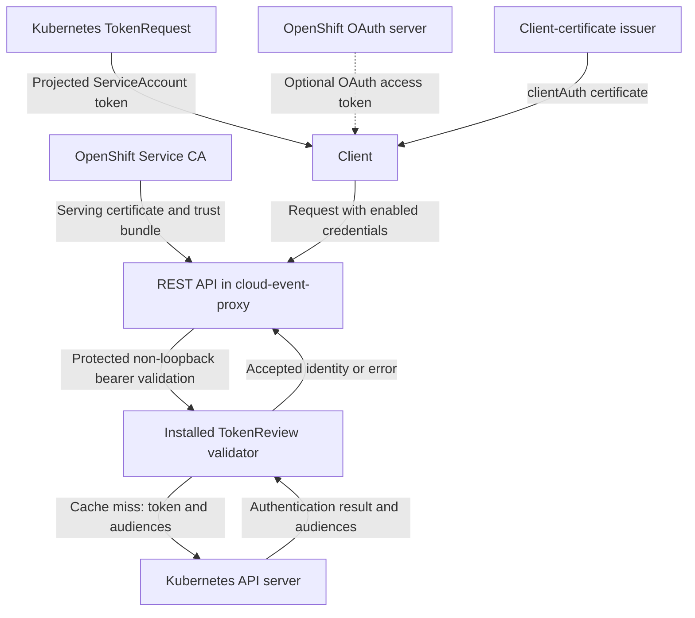

# OpenShift Authentication

This guide deploys the REST API as embedded by cloud-event-proxy, using OpenShift
Service CA for serving certificates and Kubernetes TokenReview for bearer-token
validation. Read [Authentication Configuration](AUTHENTICATION.md) for library
behavior, health exemptions, client certificates, and outbound push handling.

## Why This Approach?

### Benefits for All Cluster Sizes:

| Aspect | Single Node | Multi-Node | Improvement |
|--------|-------------|------------|-------------|
| **Complexity** | ✅ Low | ✅ Low | Same simple configuration |
| **Resource Usage** | ✅ Minimal | ✅ Minimal | No additional operators |
| **High Availability** | ❌ Single point | ✅ **HA Built-in** | OAuth server runs in HA mode |
| **Performance** | ✅ Good | ✅ **Excellent** | Better throughput in multi-node |
| **Maintenance** | ✅ Automatic | ✅ Automatic | Same automation, better resilience |
| **Cost** | ✅ Free | ✅ Free | No additional licensing |

### Comparison with Alternatives:

| Approach | Single Node | Multi-Node | Complexity | Resource Usage |
|----------|-------------|------------|------------|----------------|
| **Service CA + TokenReview** | ✅ **Perfect** | ✅ **Perfect** | ✅ Low | ✅ Minimal |
| cert-manager + Auth Operator | ⚠️ Overkill | ⚠️ Overkill | ❌ High | ❌ High |
| Service Mesh | ❌ Overkill | ⚠️ Overkill | ❌ Very High | ❌ Very High |
| Manual certificates | ⚠️ Maintenance burden | ❌ Poor | ❌ Very High | ⚠️ Low |

## Architecture

Token issuance and validation are separate operations. Projected ServiceAccount
tokens use Kubernetes TokenRequest; they do not need an OpenShift OAuth login.
An OpenShift OAuth access token is another possible input to TokenReview, subject
to the cluster's authenticators and the requested audiences. There is no direct
OAuth login or token-exchange flow in the REST API library.



The library requires a client certificate and a valid bearer token when both
mechanisms are enabled. It does not implement OAuth scope checks or
SubjectAccessReview. `GET /health` bypasses the authentication middleware;
loopback connections also bypass its checks.

cloud-event-proxy installs the validator through `Server.SetTokenValidator`.
The validator caches successful reviews for 30 seconds (maximum 4096 entries),
so validation changes may take the remaining cache TTL to become visible.

## Configuration

Use the existing `enableOAuth` field to enable bearer-token authentication.
`useOpenShiftOAuth` does not acquire a token or select an authentication backend.
`serviceAccountName` in the auth JSON does not set the pod's ServiceAccount;
use `spec.serviceAccountName` in the workload.

`useServiceCA` does not create or mount certificates. The resources below
provide the serving keypair and CA bundle, and the application reads them through
its configured paths.

The sample audience `cloud-event-proxy` must match the token projection on
clients. Do not assume `https://kubernetes.default.svc` is the API audience on
every cluster, or that a shared API audience isolates this service.

## Deployment resources

These examples show authentication resources and workload fragments, not a
complete PTP DaemonSet. Integrate them with your operator-managed deployment,
using the actual namespace, Service selectors, image and application arguments.

### Serving certificate and Service CA bundle

```yaml
apiVersion: v1
kind: Service
metadata:
  name: ptp-event-publisher-service
  namespace: openshift-ptp
  annotations:
    service.beta.openshift.io/serving-cert-secret-name: cloud-event-proxy-tls
spec:
  selector:
    app: linuxptp-daemon
  ports:
  - port: 9043
    targetPort: 9043
---
apiVersion: v1
kind: ConfigMap
metadata:
  name: cloud-event-proxy-service-ca
  namespace: openshift-ptp
  annotations:
    service.beta.openshift.io/inject-cabundle: "true"
```

Service CA creates `tls.crt` and `tls.key` in the named Secret and injects
`service-ca.crt` into the annotated ConfigMap. Use a dedicated injected
ConfigMap because injection replaces its data. See the
[Service CA architecture](https://github.com/openshift/service-ca-operator/blob/main/ARCHITECTURE.md).

Service CA supplies serving certificates, not the clientAuth certificates
required by mTLS callers. Separately provision:

- A client keypair in `cloud-event-proxy-client-tls` for outbound mTLS requests.
- A managed ConfigMap `cloud-event-proxy-trust` with `ca-bundle.crt` containing
  the client-certificate issuer CA and the serving CA chains needed for callbacks.

Maintain that combined bundle when either CA rotates; do not place manually
managed client CA data in the Service CA injection ConfigMap. The library uses
the combined bundle for both inbound client verification and outbound server
verification when mTLS is enabled.

### Server identity and TokenReview RBAC

TokenReviews are cluster-scoped. Grant permission to the ServiceAccount of the
server that performs the reviews; a namespaced Role is insufficient.

```yaml
apiVersion: v1
kind: ServiceAccount
metadata:
  name: cloud-event-proxy-sa
  namespace: openshift-ptp
---
apiVersion: rbac.authorization.k8s.io/v1
kind: ClusterRole
metadata:
  name: cloud-event-proxy-tokenreview
rules:
- apiGroups: ["authentication.k8s.io"]
  resources: ["tokenreviews"]
  verbs: ["create"]
---
apiVersion: rbac.authorization.k8s.io/v1
kind: ClusterRoleBinding
metadata:
  name: cloud-event-proxy-tokenreview
subjects:
- kind: ServiceAccount
  name: cloud-event-proxy-sa
  namespace: openshift-ptp
roleRef:
  apiGroup: rbac.authorization.k8s.io
  kind: ClusterRole
  name: cloud-event-proxy-tokenreview
```

Binding the built-in `system:auth-delegator` ClusterRole is an alternative with
broader delegated-auth permissions. The custom role above grants only the
TokenReview permission used by this validator. Clients that only present tokens
do not need this grant. A consumer that also validates tokens through TokenReview
needs an equivalent grant for its own ServiceAccount.

### Application configuration

```yaml
apiVersion: v1
kind: ConfigMap
metadata:
  name: cloud-event-proxy-auth-config
  namespace: openshift-ptp
data:
  auth-config.json: |
    {
      "enableMTLS": true,
      "caCertPath": "/etc/cloud-event-proxy/trust/ca-bundle.crt",
      "serverCertPath": "/etc/cloud-event-proxy/server-certs/tls.crt",
      "serverKeyPath": "/etc/cloud-event-proxy/server-certs/tls.key",
      "clientCertPath": "/etc/cloud-event-proxy/client-certs/tls.crt",
      "clientKeyPath": "/etc/cloud-event-proxy/client-certs/tls.key",
      "enableOAuth": true,
      "requiredAudiences": ["cloud-event-proxy"],
      "serviceAccountToken": "/var/run/secrets/cloud-event-proxy/token"
    }
```

`requiredAudiences` configures inbound validation. `serviceAccountToken` is
the credential used for outbound HTTPS callbacks; the callback must accept its
audience. It is separate from the Kubernetes API credential used by the
TokenReview client.

### Workload mounts and projected token

Merge this fragment into the workload's pod template. Ensure the separately
provisioned trust ConfigMap and client Secret exist first.

```yaml
spec:
  template:
    spec:
      serviceAccountName: cloud-event-proxy-sa
      automountServiceAccountToken: true
      containers:
      - name: cloud-event-proxy
        args:
        - "--auth-config=/etc/cloud-event-proxy/auth/auth-config.json"
        volumeMounts:
        - name: server-certs
          mountPath: /etc/cloud-event-proxy/server-certs
          readOnly: true
        - name: client-certs
          mountPath: /etc/cloud-event-proxy/client-certs
          readOnly: true
        - name: trust
          mountPath: /etc/cloud-event-proxy/trust
          readOnly: true
        - name: auth-config
          mountPath: /etc/cloud-event-proxy/auth
          readOnly: true
        - name: event-token
          mountPath: /var/run/secrets/cloud-event-proxy
          readOnly: true
      volumes:
      - name: server-certs
        secret:
          secretName: cloud-event-proxy-tls
      - name: client-certs
        secret:
          secretName: cloud-event-proxy-client-tls
      - name: trust
        configMap:
          name: cloud-event-proxy-trust
      - name: auth-config
        configMap:
          name: cloud-event-proxy-auth-config
      - name: event-token
        projected:
          sources:
          - serviceAccountToken:
              path: token
              audience: cloud-event-proxy
              expirationSeconds: 3600
```

Keep the default Kubernetes API token mount for the in-cluster TokenReview
client. The additional `event-token` volume supplies the separate audience-bound
credential for callbacks. Configure callers with the same projection audience
and their own ServiceAccount. Kubernetes rotates projected tokens; the outbound
HTTP transport rereads its token file per HTTPS request. See
[Kubernetes ServiceAccounts](https://kubernetes.io/docs/concepts/security/service-accounts/).

The library does not watch certificate/CA files for updates. Arrange a reload or
restart when the serving certificate, client certificate, or combined trust
bundle changes.

## Verification and troubleshooting

Run certificate and protected endpoint checks from a separate client pod using
the Service DNS name, not localhost. See the
[client examples](AUTHENTICATION.md#client-examples).

```bash
# Check certificate and trust resources without printing private keys or tokens.
oc get secret cloud-event-proxy-tls cloud-event-proxy-client-tls -n openshift-ptp
oc get configmap cloud-event-proxy-service-ca cloud-event-proxy-trust -n openshift-ptp

# Check the server's cluster-scoped validation permission.
oc auth can-i create tokenreviews.authentication.k8s.io \
  --as=system:serviceaccount:openshift-ptp:cloud-event-proxy-sa

# Health uses HTTPS when mTLS is enabled, but needs no client credentials.
curl --cacert service-ca.crt \
  https://ptp-event-publisher-service.openshift-ptp.svc:9043/api/ocloudNotifications/v2/health
```

| Symptom | Check |
| --- | --- |
| HTTP 401: token validation unavailable | Embedding application installed a TokenValidator |
| TokenReview API error | API-server connectivity, API credentials, and server SA permissions |
| Token rejected or audience mismatch | Token expiry, requested audience, and cluster authentication support |
| Client certificate required | Client supplied a clientAuth certificate trusted by the configured bundle |
| TLS certificate verification failure | Certificate usage, issuer trust, expiry, and server DNS names |
| Callback rejects initial notification | Outbound token audience and client certificate match consumer requirements |

For a projected ServiceAccount-token deployment, monitor Kubernetes API
availability and TokenReview errors. OAuth server troubleshooting is relevant
when clients obtain OAuth access tokens, not as the primary dependency for
ServiceAccount token validation. Multi-node deployments still depend on the
control plane and certificate provisioning; this library does not guarantee
automatic failover or throughput improvements as nodes are added.

## Implementation references

- [REST API TokenValidator and middleware](v2/auth.go)
- [REST API listener and outbound HTTP client](v2/server.go)
- [cloud-event-proxy validator installation](https://github.com/redhat-cne/cloud-event-proxy/blob/main/pkg/common/common.go)
- [cloud-event-proxy TokenReview implementation](https://github.com/redhat-cne/cloud-event-proxy/blob/main/pkg/auth/tokenreview.go)
